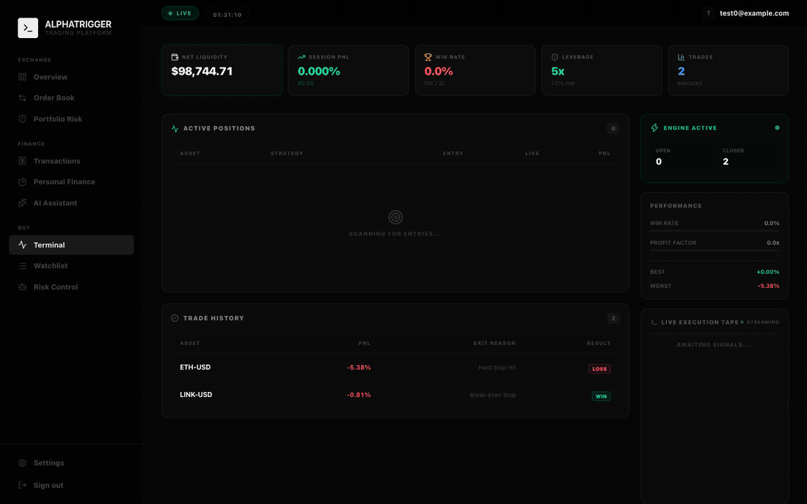
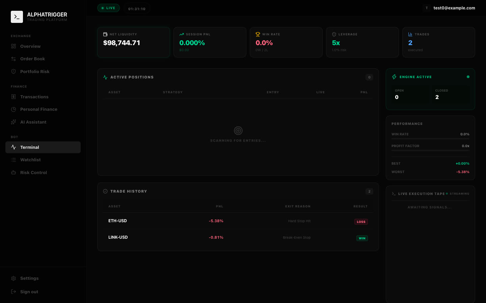
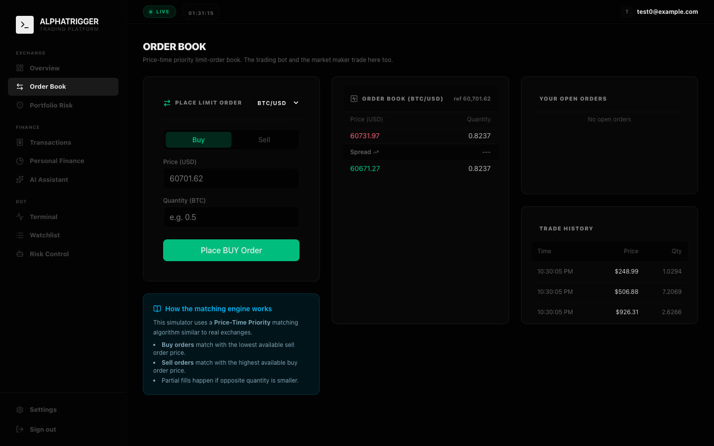
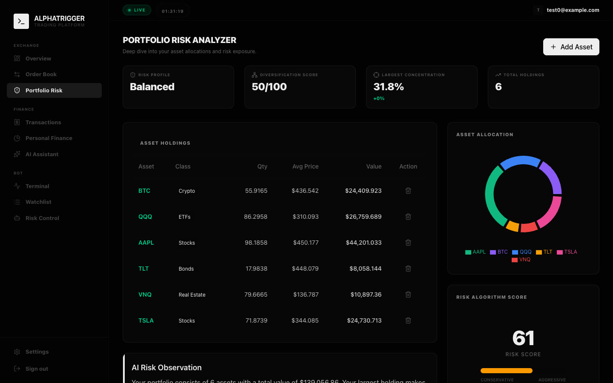
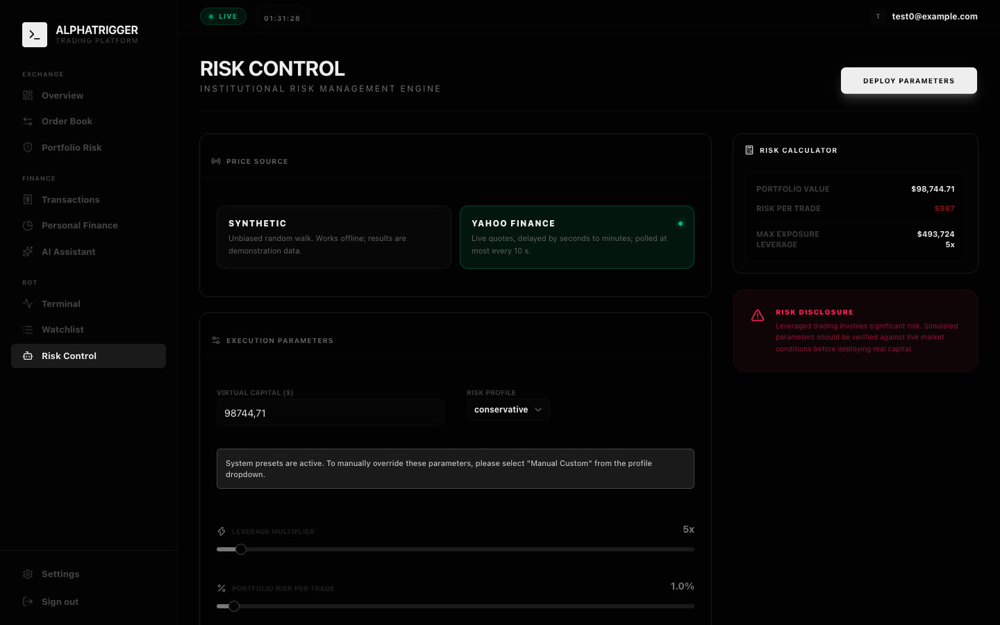

# Trading Platform

[](https://github.com/yigitsarpavci/trading-platform/actions/workflows/ci.yml)
[](#testing)
[](LICENSE)

One app with a simulated exchange and a trading bot that trades on it. Users place limit orders on a price-time-priority order book, track their personal finances and portfolio risk, and watch the bot trade on the same book in a live terminal. Prices come from a synthetic random walk or, with one click, from Yahoo Finance.

FastAPI, SQLAlchemy and PostgreSQL on the backend; one Next.js 16 app on the frontend.

> Educational project. No real money, exchange or brokerage is involved, and nothing here is financial advice.

---

## Quick Start

```bash
docker compose up --build
# web: http://localhost:3000    API docs: http://localhost:8000/docs
docker compose exec api python app/db/seed.py   # demo data; sign in as test0@example.com / password123
```

The bot starts with the API and begins trading after about a minute (it needs 30 price ticks). To start on live prices, run `MARKET_DATA_PROVIDER=yfinance docker compose up --build`, or switch on the bot's **Risk Control** page.

Without Docker:

```bash
cd backend && pip install -r requirements.txt
DATABASE_URL=sqlite:///./platform.db uvicorn app.main:app --port 8000
cd frontend && npm ci && npm run dev    # http://localhost:3000
```

## Screenshots



| | |
| :---: | :---: |
|  |  |
| *Bot terminal: positions, trade history, live tape* | *Order book with the market maker's quotes (live Yahoo price)* |
|  |  |
| *Portfolio risk analyzer* | *Bot risk control and price-source switch* |

---

## What It Does

**Exchange**
- **Order book.** Limit orders match on price-time priority: a buy takes the cheapest resting sell at or below its limit, oldest first, and vice versa. Fills execute at the resting (maker) price and can be partial; a user's own resting orders are skipped. GTC orders rest, IOC orders cancel what does not fill at once, and open orders can be canceled.
- **Pre-trade checks and settlement.** A buy needs free cash and a sell needs free holdings (open orders reserve both). Every fill moves cash between the two accounts and updates both portfolios, so the risk analyzer sees exchange positions.
- **Market maker.** Each reference price makes a built-in market maker quote a bid and an ask around it (10 bps spread, 50,000 per side), so there is always liquidity.

**Finance**
- Transactions, monthly cash flow and a 0–100 health score (savings rate, expenses vs income).
- Portfolio risk: allocation, a weighted risk score (Crypto 90 … Cash 10) and a diversification score.
- An AI assistant (`gpt-3.5-turbo`) with deterministic rule-based answers when no key is set.

**Bot**
- Every 2 seconds: read quotes, publish them to the exchange as reference prices, score entries, open positions with IOC orders on the order book, and manage exits.
- **Entry** needs at least 4 points: price > 1.5σ above its 120-tick mean (+1), > 2.5σ (+1), last two ticks rising (+1), market not flat (+1), BTC not falling (+1), volume spike (+1), a loss on this coin in the last 15 minutes (−2).
- **Size** from the stop distance: stop = `max(0.8%, 3 × volatility)`, target = 2 × stop, notional = `0.25% × portfolio ÷ stop%`, capped at 20% of the portfolio.
- **Exits**, first that fires: hard stop · no follow-through (45 s, < 0.1% best excursion) · break-even (after +0.5R) · trailing (after +0.8R, gives back > 0.4R) · target · time stop (300 s). Five consecutive losses or a daily loss limit pause trading.
- **Price source**: synthetic random walk (default, offline) or Yahoo Finance (live, delayed, polled at most every 10 s), switchable at runtime when the bot holds no position.

## Architecture

```mermaid
flowchart LR
    Web["Next.js app<br/>exchange · finance · bot terminal"] -->|REST + JWT| API
    Web -. WebSocket .-> API
    subgraph API["FastAPI (one process)"]
        Ex["Exchange<br/>matching · settlement · market maker"]
        Fin["Finance · risk · AI"]
        Bot["Bot loop<br/>scoring · sizing · exits"]
        Bot -->|IOC orders, reference prices<br/>(in process)| Ex
    end
    Feed["Synthetic feed /<br/>Yahoo Finance"] --> Bot
    API --> DB[("PostgreSQL<br/>one schema")]
```

The bot lives in `backend/app/bot` and talks to the exchange only through two functions (`place_order`, `publish_reference_prices`) behind an `ExchangeExecution` class, the same path a user's order takes.

---

## Design Decisions & Trade-offs

- **One app, bot as a module.** The bot only decides what to buy and sell, so it runs as a background task inside the API and calls the exchange in process: one deploy, one database, one login, no HTTP client between them. The cost is coupling the bot's lifecycle to the web server; the narrow execution interface keeps it separable.
- **Only one bot, however many workers.** A PostgreSQL advisory lock elects a single runner, so two workers never open the same position twice.
- **A market maker instead of an empty book.** Without resting liquidity an IOC order would never fill. Two-sided quotes give a real spread to pay and real partial fills. The maker has an unlimited balance sheet, so its account is not a P&L.
- **IOC orders with a tolerance.** A strategy that re-evaluates every 2 seconds should not leave stale orders; anything that does not fill within 20 bps of the quote is canceled.
- **Matching one asset at a time.** Placing an order locks the asset row (`SELECT … FOR UPDATE`) for the check, match and settlement.
- **Synthetic prices by default.** They work offline and make tests reproducible; Yahoo Finance is one switch away. Switching is refused while the bot holds a position, because the two feeds are on different price scales.
- **Bot tables are prefixed** (`bot_accounts`, `bot_paper_trades`, …) so they share one schema with the exchange without name clashes.

## Known Limitations

- Yahoo Finance quotes are delayed and rate-limited; the bot caches them for 10 s.
- The exchange settles the full notional in cash (no margin), while the bot's own P&L applies its configured 5× leverage.
- Limit orders only (GTC and IOC); no fees on the exchange, no market or stop orders.
- The bot keeps price buffers and risk guards in memory; they reset on restart.
- Bot settings and the price source are global (one bot), not per user. Reading the bot is public; changing it needs a signed-in user.
- Exchange users authenticate with a JWT stored in `localStorage`.

---

## API

Interactive docs at `/docs`. Everything is under `/api/v1`.

| Area | Endpoints |
| :--- | :--- |
| Auth | `POST /auth/register`, `POST /auth/login`, `GET /auth/me` |
| Exchange | `POST /trading/orders` (GTC/IOC), `DELETE /trading/orders/{id}`, `GET /trading/orders`, `GET /trading/account`, `GET /trading/order-book`, `GET /trading/trades`, `GET /market/prices`, `PUT /market/prices` (market operators) |
| Finance | `GET /finance/monthly-summary`, `/category-breakdown`, `/cash-flow`, `/financial-health-score`; `GET`/`POST /transactions/` |
| Portfolio | `GET /portfolio/`, `POST /portfolio/assets`, `GET /portfolio/allocation`, `GET /portfolio/risk-analysis` |
| AI | `POST /ai/financial-summary`, `/portfolio-risk-summary`, `/monthly-report`, `GET /ai/insights` |
| Bot | `GET /bot/settings/`, `POST /bot/settings/update` (incl. `market_data_provider`), `GET`/`POST`/`DELETE /bot/watchlist/`, `GET /bot/paper-trades/`, `/bot/paper-trades/summary`, `GET /bot/user/portfolio`, `WS /bot/ws/` |

## Configuration

| Variable | Default | Description |
| :--- | :--- | :--- |
| `DATABASE_URL` | PostgreSQL | Any SQLAlchemy URL, e.g. `sqlite:///./platform.db` |
| `SECRET_KEY` | dev value | JWT signing key; required in production |
| `MARKET_DATA_PROVIDER` | `mock` | `mock` (synthetic) or `yfinance` (live Yahoo Finance) |
| `BOT_ENABLED` | `true` | Start the trading loop with the API |
| `EXECUTION_MODE` | `exchange` | `exchange` (platform order book) or `simulated` (local fills) |
| `MARKET_MAKER_SPREAD_BPS`, `MARKET_MAKER_QUOTE_NOTIONAL` | `10`, `50000` | Market maker spread and size per side |
| `OPENAI_API_KEY` | unset | LLM answers for the AI assistant |
| `NEXT_PUBLIC_API_URL` (web) | `http://localhost:8000` | API address, set at build time |

## Testing

```bash
cd backend && BOT_ENABLED=false PYTHONPATH=. pytest app --cov=app/services --cov=app/bot/services
```

143 pytest tests, 75% service coverage (exchange 85%, bot 72%), CI fails below 70%:

- **Exchange:** matching and price-time priority, cash and holding checks with reservations, settlement, IOC, cancellation, self-trade prevention, market-maker quotes, the operator-only price endpoint, schema upgrades.
- **Bot:** entry scoring, sizing, every exit rule, loss guards, missing/partial/full fills, a full round trip on the real order book (paying the spread), the price-source switch and its guard, the Yahoo cache, auth on bot settings.
- **Finance:** auth and hashing, health score, risk analysis, AI fallbacks.

CI runs the suite on PostgreSQL, lints and builds the web app, and starts the whole Docker stack to check that the bot publishes prices to the exchange. CodeQL, Dependabot and secret scanning run on the repository; release tags publish the API and web images to GHCR.

## Repository Layout

```text
├── backend/app/
│   ├── api/, models/, services/   # exchange, finance, portfolio, AI
│   └── bot/                       # trading loop, scoring, sizing, exits, execution, market data
├── frontend/src/app/              # one Next.js app: exchange, finance and /bot pages
├── docker-compose.yml             # PostgreSQL, API, web
└── .github/workflows/             # CI and image publishing
```

## License

[MIT](LICENSE) · Yiğit Sarp Avcı · [GitHub](https://github.com/yigitsarpavci) · [LinkedIn](https://www.linkedin.com/in/yigitsarpavci)
