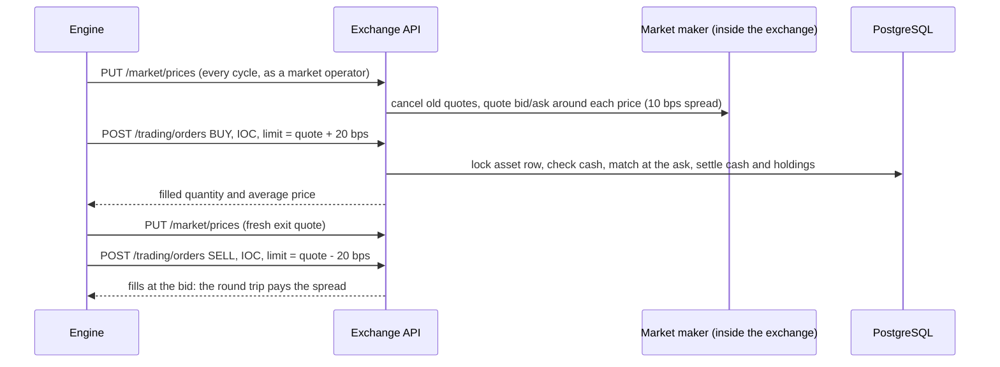

# Trading Platform

[](https://github.com/yigitsarpavci/trading-platform/actions/workflows/ci.yml)
[](https://github.com/yigitsarpavci/trading-platform/security)
[](LICENSE)

Two services that form one simulated market:

- **[Exchange](exchange)**: a FastAPI + PostgreSQL limit-order book with price-time priority, pre-trade checks, settlement into cash and portfolio holdings, and a market maker. It is also a personal-finance and portfolio-risk app (Next.js UI) whose users trade on the same book.
- **[Engine](engine)**: an algorithmic trading engine that scans five crypto pairs every 2 seconds, scores z-score breakouts, sizes positions from their stop distance, manages exits with six risk rules, and sends every entry and exit to the exchange as an immediate-or-cancel order. A Next.js terminal streams it live over WebSockets.

> Educational project with synthetic prices. No real money, exchange or brokerage is involved, and nothing here is financial advice.

---

## Quick Start

```bash
docker compose up --build
```

| | URL |
| :--- | :--- |
| Engine terminal | <http://localhost:3000> |
| Exchange UI | <http://localhost:3001> (seed demo users: `docker compose exec exchange-api python app/db/seed.py`, then sign in as `test0@example.com` / `password123`) |
| Engine API | <http://localhost:8000/docs> |
| Exchange API | <http://localhost:8001/docs> |

The engine starts trading on its own once it has 30 ticks of history (about a minute). Its fills appear in the exchange's order book and trade history, and settle into the engine account's cash and holdings.

---

## How the Two Services Work Together



- The engine signs in with its own exchange account (registered on first use). Only accounts in `MARKET_OPERATOR_EMAILS` may publish prices.
- No fill means no trade; an exit with no liquidity stays open and retries; a partial exit books the sold part.
- With `EXECUTION_MODE=simulated` (the default outside Docker) the engine runs alone and simulates fills locally.

## Screenshots

| Engine terminal | Exchange |
| :---: | :---: |
|  |  |

---

## Design Decisions & Trade-offs

- **Two services, not one app.** The engine is a long-running loop and the exchange is a request/response system of record; they scale, fail and deploy differently. They share nothing but a REST contract, so either can be replaced (the engine already runs against a local simulator).
- **The engine is the price source.** Prices are synthetic, so the engine publishes them as a market operator and the exchange's market maker quotes around them. A real venue would take prices from its own book and external feeds.
- **A market maker instead of an empty book.** Without resting liquidity an IOC order would never fill. Two-sided quotes give a real spread to pay and real partial fills. The maker has an unlimited balance sheet, so its account is not a P&L.
- **IOC orders with a tolerance.** A strategy that re-evaluates every 2 seconds should not leave stale orders resting; anything that does not fill within 20 bps is canceled.
- **Matching one asset at a time.** Placing an order locks the asset row (`SELECT … FOR UPDATE`) for the check, match and settlement, so two orders cannot take the same resting order.
- **Monorepo.** Both histories were imported with `git filter-repo`, so `git log -- exchange/` and `git log -- engine/` still show each service's full history.

## Known Limitations

- Synthetic random-walk prices; trade results demonstrate mechanics, not a strategy's edge.
- The exchange settles the full notional in cash (no margin), while the engine's own P&L applies its configured 5× leverage.
- Limit orders only (GTC and IOC); no fees on the exchange, no market or stop orders.
- The engine keeps its price buffers and risk guards in memory and runs as a single process.
- Exchange users authenticate with a JWT stored in `localStorage`.

Each service's README lists its own limitations in detail.

---

## Testing

| Suite | What it covers |
| :--- | :--- |
| Exchange, 36 pytest tests (85% service coverage, PostgreSQL in CI) | Matching and price-time priority, cash and holding checks with reservations, settlement, IOC, cancellation, self-trade prevention, market-maker quotes, the operator-only price endpoint, schema upgrades, auth, finance and risk scoring, AI fallbacks |
| Engine, 103 pytest tests (65% service coverage) | Entry scoring, sizing, every exit rule, loss guards, the exchange client against a fake exchange, missing/partial/full fills |
| Integration | Starts the exchange and runs a real publish → buy → sell round trip from the engine's client |
| Frontends | ESLint and a production Next.js build for both apps |
| Docker | Builds every image of the compose stack and imports both APIs |

```bash
cd exchange/backend && PYTHONPATH=. pytest app/tests
cd engine/backend && PYTHONPATH=. pytest tests
```

CodeQL, Dependabot (pip, npm, Docker, Actions for both services) and secret scanning run on the repository. Release tags publish both API images to GHCR.

## Repository Layout

```text
├── docker-compose.yml     # PostgreSQL, exchange API + web, engine API + web
├── exchange/              # FastAPI + Next.js: order book, settlement, market maker, finance and risk app
├── engine/                # FastAPI + Next.js: trading loop, scoring, sizing, exits, execution client
├── scripts/               # database bootstrap for the compose stack
└── .github/workflows/     # CI (both services, integration, Docker) and image publishing
```

## License

[MIT](LICENSE) · Yiğit Sarp Avcı · [GitHub](https://github.com/yigitsarpavci) · [LinkedIn](https://www.linkedin.com/in/yigitsarpavci)
