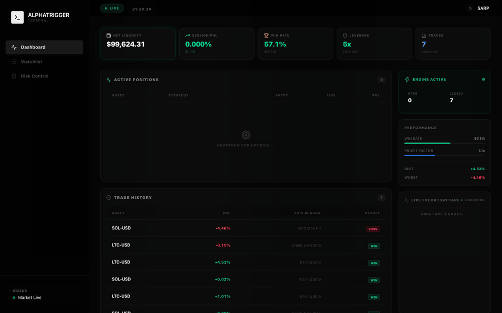
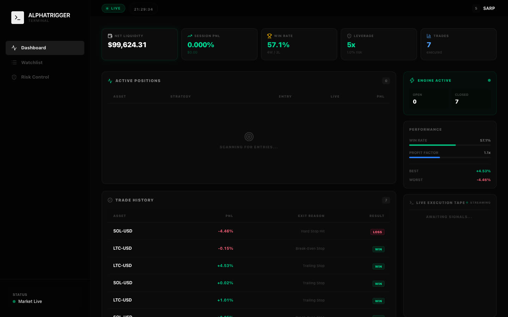
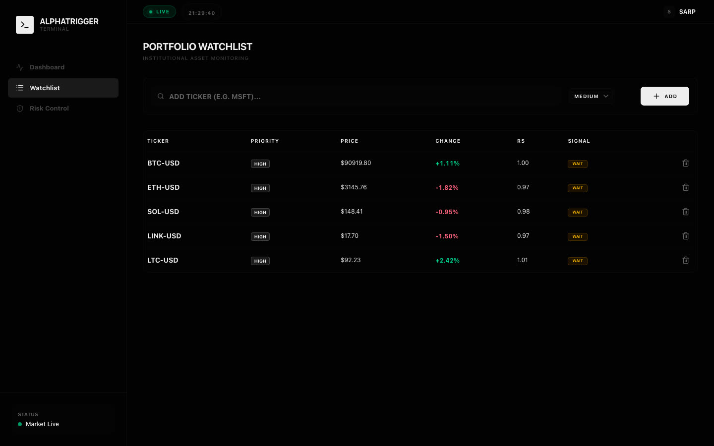
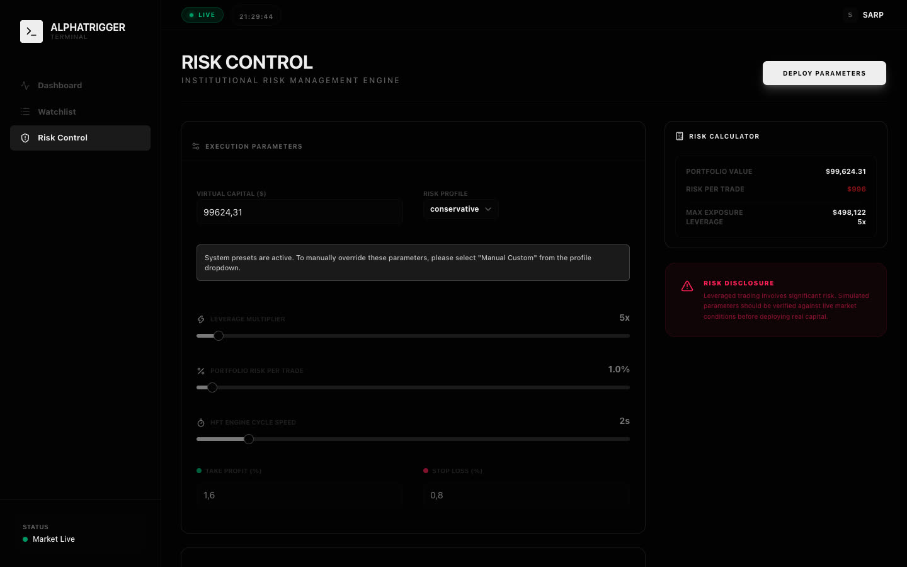
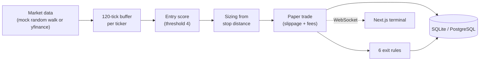

# Algorithmic Trading Simulator

[](https://github.com/yigitsarpavci/algorithmic-trading-simulator/actions/workflows/ci.yml)
[](#testing)
[](LICENSE)

A paper-trading simulator: a FastAPI engine scans five crypto pairs every 2 seconds, scores z-score breakouts, sizes each position from its stop distance, manages exits with six risk rules, and streams everything over WebSockets to a Next.js terminal. Fills are simulated locally by default, or routed as real limit orders to the matching engine of the [Financial Analytics Dashboard](https://github.com/yigitsarpavci/financial-analytics-dashboard) (exchange mode). No real money or exchange is involved.

> Educational project. It does not connect to an exchange or a brokerage account, and nothing here is financial advice.

---

## Quick Start

```bash
# backend (SQLite, no external services needed)
cd backend && python -m venv venv && source venv/bin/activate && pip install -r requirements.txt
DATABASE_URL=sqlite:///./alphatrigger.db uvicorn app.main:app --port 8000

# frontend, in a second terminal
cd frontend && npm ci && npm run dev   # http://localhost:3000
```

`docker-compose up --build` runs the same stack on PostgreSQL. API docs: <http://localhost:8000/docs>.

---

## Screenshots



| | |
|---|---|
|  |  |
| *Dashboard: engine status, performance and trade history* | *Watchlist* |
|  |  |
| *Risk control settings* |  |

The screenshots use the default synthetic feed (an unbiased random walk), so the trade results are demonstration data, not a performance claim.

---

## How It Works



Every 2 seconds the engine (an `asyncio` task started with the API) runs one cycle:

1. **Buffer.** Each quote is appended to a 120-tick in-memory buffer per ticker. A ticker needs 30 ticks before it can trade.
2. **Score.** A long entry needs at least 4 points:

   | Rule | Points |
   | :--- | :---: |
   | Price more than 1.5σ above the buffer mean | +1 |
   | Price more than 2.5σ above the mean | +1 |
   | Last two ticks rising | +1 |
   | Buffer range above 0.03% (market not flat) | +1 |
   | BTC rate of change ≥ -0.01% | +1 |
   | Volume up by more than 10,000 since the last tick | +1 |
   | A loss on this ticker in the last 15 minutes | -2 |

3. **Size.** Volatility is the standard deviation of tick-to-tick returns. The stop is `max(0.8%, 3 × volatility)` below entry and the target is twice that distance (1:2 risk/reward). The position risks 0.25% of the portfolio, so its notional is `0.25% × portfolio / stop%`: calmer markets get larger positions, volatile ones smaller. One position is capped at 20% of the portfolio, and quantities are fractional.
4. **Fill.** Entries and exits pay random slippage (up to 0.02%) and a 0.04% commission. P&L is computed at 5× leverage.
5. **Exit.** Open trades are re-priced every cycle and closed by the first rule that fires:

   | Rule | Fires when |
   | :--- | :--- |
   | Hard stop | price reaches the stop |
   | No follow-through | 45 s old and the best excursion is still under 0.1% |
   | Break-even stop | the trade reached +0.5R, then fell back to ≤ 0 |
   | Trailing stop | the trade reached +0.8R, then gave back more than 0.4R |
   | Target | price reaches the target |
   | Time stop | 300 s old |

   A session-level guard pauses trading after 5 consecutive losses or a daily loss limit.

The terminal receives `PRICE_BATCH_UPDATE`, `SIGNAL_GENERATED`, `PORTFOLIO_UPDATE` and `SYNC_TRIGGER` events and reconnects with a capped backoff if the socket drops.

---

## Exchange Mode

With `EXECUTION_MODE=exchange` the engine stops simulating fills and trades on the [Financial Analytics Dashboard](https://github.com/yigitsarpavci/financial-analytics-dashboard)'s limit-order book:

```mermaid
sequenceDiagram
    participant E as Trading engine
    participant X as Exchange (Financial backend)
    participant MM as Market maker (inside X)
    E->>X: PUT /market/prices (each cycle, as market operator)
    X->>MM: re-quote bid / ask around each price
    E->>X: POST /trading/orders BUY, IOC, limit = quote + 20 bps
    X-->>E: fills at the ask (maker price), settled into cash and holdings
    E->>X: PUT /market/prices (fresh exit quote)
    E->>X: POST /trading/orders SELL, IOC, limit = quote - 20 bps
    X-->>E: fills at the bid; the round trip pays the spread
```

- The engine signs in with its own account (registered on first use) and must be listed in the exchange's `MARKET_OPERATOR_EMAILS` to publish prices.
- Entries use the filled quantity and the volume-weighted fill price. No fill means no trade. An exit that finds no liquidity within the tolerance stays open and retries next cycle. A partial exit books the sold part and keeps the rest open.
- Engine tickers map to exchange symbols by dropping the quote currency (`BTC-USD` → `BTC`).

```bash
# terminal 1: the exchange (financial-analytics-dashboard/backend)
DATABASE_URL=sqlite:///./exchange.db MARKET_OPERATOR_EMAILS=trading-engine@example.com uvicorn app.main:app --port 8001
# terminal 2: this engine
DATABASE_URL=sqlite:///./alphatrigger.db EXECUTION_MODE=exchange EXCHANGE_URL=http://localhost:8001 \
  EXCHANGE_PASSWORD=choose-one uvicorn app.main:app --port 8000
```

CI runs a round trip (publish, buy, sell, check the account is flat) against the exchange started from its own repository.

---

## Design Decisions & Trade-offs

- **Fixed dollar risk, not fixed position size.** Sizing from the stop distance keeps the loss at the stop roughly constant across BTC and a small-cap coin. The 20% cap exists because a very tight stop would otherwise imply an enormous position.
- **Execution behind one interface.** `SimulatedExecution` and `ExchangeExecution` expose the same `buy` / `sell` / `publish_prices`, so the scoring, sizing and exit logic is identical in both modes; only where fills come from changes.
- **IOC orders for the engine.** A strategy that re-evaluates every 2 seconds should not leave stale orders on the book, so every entry and exit is immediate-or-cancel with a price tolerance.
- **Exit rules over a single take-profit.** Short-horizon signals decay fast. The no-follow-through and time stops close trades that never move, instead of letting them drift into the hard stop.
- **In-process loop and in-memory state.** The engine, the price buffers and the WebSocket connection list live in the API process. That keeps the project to one service with no broker or cache to run, at the cost of horizontal scaling (see below).
- **Unbiased mock feed by default.** The default feed is a random walk with no drift (seedable for tests), so the engine can be demoed offline and a "profitable" result cannot come from a biased generator. A feed with momentum earlier produced an unrealistic 92% win rate and was removed.
- **SQLite for development, PostgreSQL in Docker.** Both go through SQLAlchemy; tables are created on startup.

## Known Limitations

- **Leverage is local.** In exchange mode the exchange settles the full notional in cash (no margin), while the engine's own P&L still applies its configured leverage.
- **Not a backtester.** Results come from a live simulation of the current feed. There is no historical replay, so strategy changes cannot be compared on the same data.
- **Exits are checked every 2 seconds** at the current price, so a stop can fill past its level by however far the price moved within one cycle.
- **State resets on restart.** Price buffers, loss penalties and the consecutive-loss guard are in memory.
- **Single process.** Running two API workers would run two engines and split WebSocket clients between them.
- **Long-only.** The live engine only opens BUY trades. The `strategies/` package (VWAP pullback, opening-range breakout, consolidation breakout, 20-DMA pullback, crypto momentum) feeds the signals API, not the trading loop.
- **No schema migrations.** Tables come from `create_all`; changing a model on an existing database needs a manual migration.
- **yfinance quotes are delayed** and rate-limited; the mock feed is the reliable default.

---

## API

Interactive docs at `/docs`.

| Method | Endpoint | Description |
| :--- | :--- | :--- |
| `GET` / `POST` | `/api/v1/watchlist/` | List or add watchlist tickers |
| `DELETE` | `/api/v1/watchlist/{id}` | Remove a ticker |
| `GET` | `/api/v1/paper-trades/` | Last 100 paper trades |
| `GET` | `/api/v1/paper-trades/summary` | Win rate, P&L and trade counts |
| `GET` | `/api/v1/user/portfolio` | Portfolio value and liquidity |
| `GET` | `/api/v1/signals/` | Generated signals |
| `GET` | `/api/v1/settings/` | Engine configuration |
| `WS` | `/api/v1/ws/` | Live event stream |

## Configuration

| Variable | Default | Description |
| :--- | :--- | :--- |
| `DATABASE_URL` | PostgreSQL from `POSTGRES_*` | Any SQLAlchemy URL, e.g. `sqlite:///./alphatrigger.db` |
| `POSTGRES_SERVER` / `_USER` / `_PASSWORD` / `_DB` | `localhost` / `user` / `password` / `alphatrigger` | Used when `DATABASE_URL` is not set |
| `FRONTEND_CORS_ORIGINS` | `localhost:3000` | Comma-separated browser origins allowed by the API |
| `MARKET_DATA_PROVIDER` | `mock` | `mock` (synthetic random walk) or `yfinance` |
| `OPENAI_API_KEY` | unset | Enables the optional AI trade explainer |
| `EXECUTION_MODE` | `simulated` | `simulated` or `exchange` |
| `EXCHANGE_URL` / `EXCHANGE_EMAIL` / `EXCHANGE_PASSWORD` | `localhost:8001` / `trading-engine@example.com` / unset | Exchange address and the engine's account (password required in exchange mode) |
| `EXCHANGE_PRICE_TOLERANCE_BPS` | `20` | How far past the quote an IOC order may fill |

The frontend needs no configuration; it derives the API and WebSocket address from the page host.

## Testing

```bash
cd backend
pip install -r requirements.txt pytest pytest-cov
PYTHONPATH=. python -m pytest tests -q --cov=app/services
```

102 tests cover the indicators, entry scoring and its signal bands, the market-regime classifier, position sizing (risk-normalized notional, the 20% cap and the fallback), risk/reward validation, every exit rule against an in-memory database, the consecutive-loss and daily-loss guards, the exchange client against a fake exchange (registration, token refresh, IOC limits, rejections) and the engine's handling of missing, partial and full fills, startup table creation, the mock feed, and two strategies. `app/services` coverage is 65% (the paper-trading engine alone is 86%); CI fails below 55% and also runs ESLint and a production Next.js build.

## Stack

FastAPI, SQLAlchemy 2, Pydantic 2, `asyncio`, httpx · Next.js 16, React 19, Tailwind CSS 4 · SQLite / PostgreSQL · Docker Compose · GitHub Actions, CodeQL, Dependabot.

## License

[MIT](LICENSE) · Yiğit Sarp Avcı · [GitHub](https://github.com/yigitsarpavci) · [LinkedIn](https://www.linkedin.com/in/yigitsarpavci)
