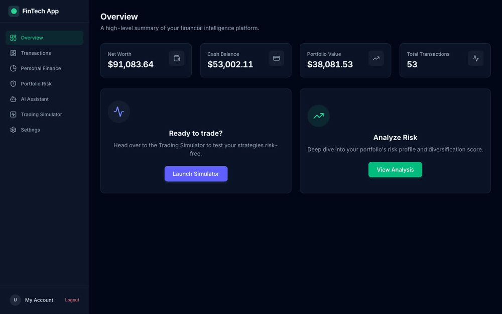
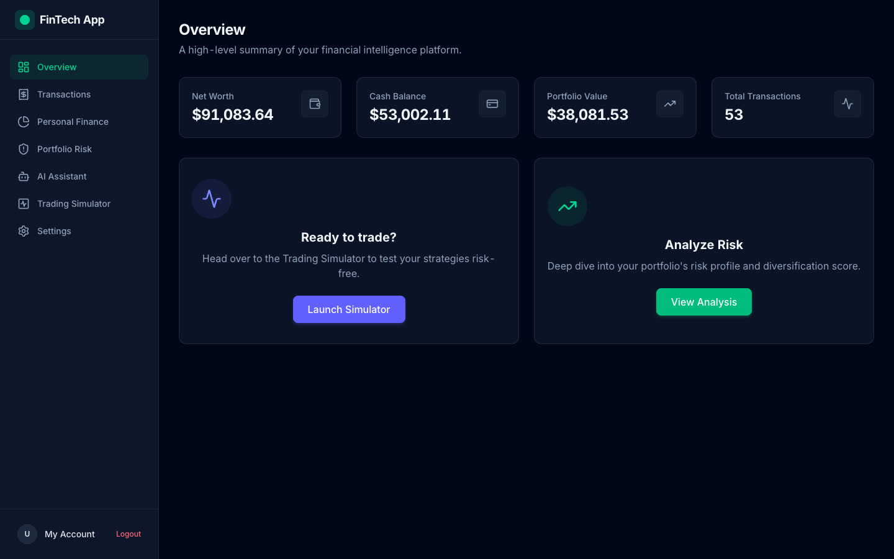
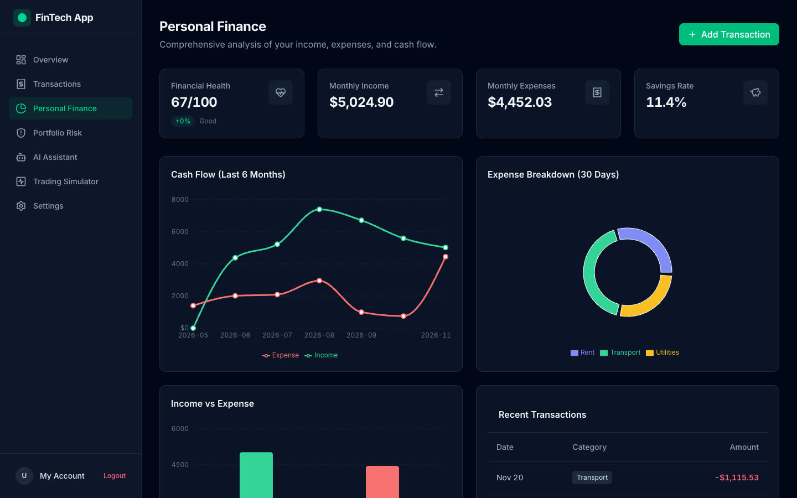
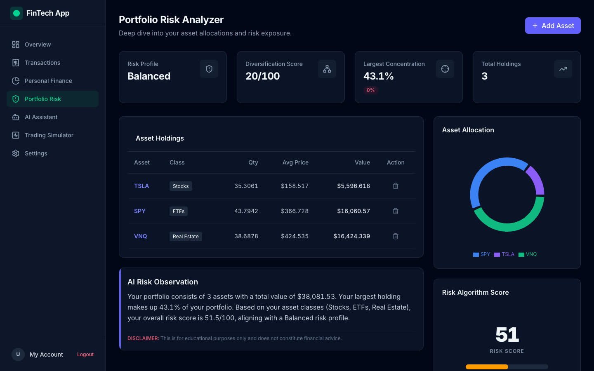
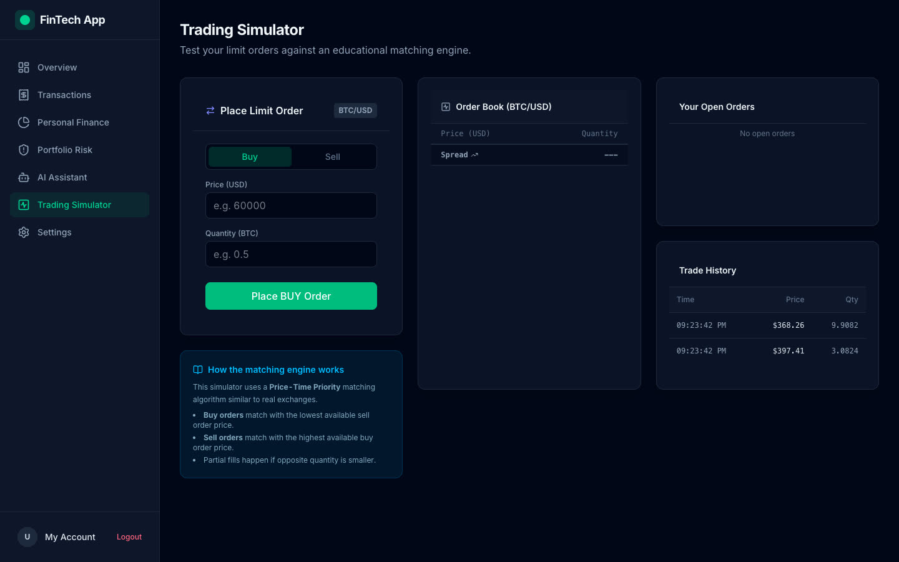
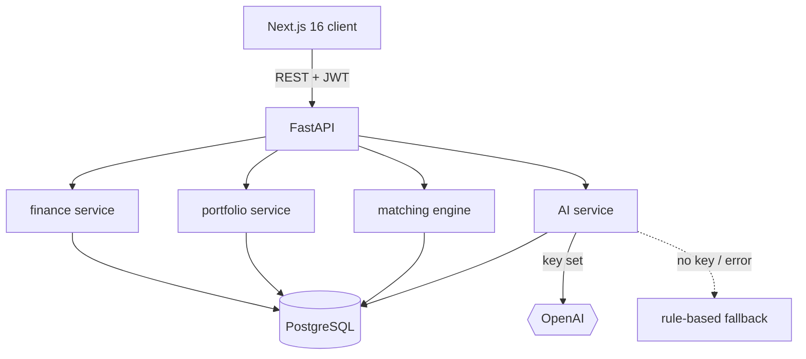
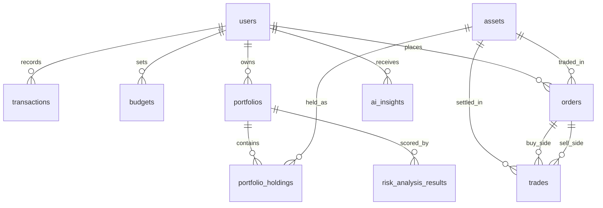

# Financial Analytics Dashboard

[](https://github.com/yigitsarpavci/financial-analytics-dashboard/actions/workflows/backend-pytest.yml)
[](#testing)
[](LICENSE)

A full-stack personal-finance and portfolio app: transaction tracking with a financial health score, a portfolio risk analyzer, a limit-order matching engine for a simulated exchange, and an AI assistant that falls back to rule-based answers when no OpenAI key is configured. FastAPI and PostgreSQL on the backend, Next.js 16 on the frontend.

> Educational project. Nothing here is financial advice.

---

## Quick Start

```bash
docker compose up --build
# UI: http://localhost:3000   API docs: http://localhost:8000/docs
docker compose exec backend python app/db/seed.py   # demo data; sign in as test0@example.com / password123
```

The backend image is also published to GHCR on every release tag.

---

## Screenshots

Captured with the seeded demo data (50 users, 2,500+ transactions).



| | |
|---|---|
|  |  |
| *Overview* | *Personal finance: cash flow, expense breakdown, health score* |
|  |  |
| *Portfolio risk analyzer: allocation, diversification, risk score* | *Trading simulator with limit-order matching* |

---

## What It Does

- **Personal finance.** Income/expense tracking, category breakdowns, monthly cash flow, and a 0–100 health score: 50 base points, up to +30 for the savings rate (full marks at 20%), −20 when expenses exceed income.
- **Portfolio risk.** Allocation by holding and asset class, a weighted risk score (Crypto 90, Stocks 60, ETFs 50, Bonds 30, Cash 10 …) mapped to Conservative / Balanced / Aggressive, and a diversification score (10 points per holding, −10 or −20 when the largest position exceeds 30% or 50%).
- **Limit-order matching.** Orders match on **price-time priority**: a buy takes the cheapest resting sell at or below its limit, oldest first, and vice versa. Fills execute at the resting (maker) price, support partial fills across several counter-orders, and the order book endpoint aggregates open quantity per price level.
- **AI assistant.** Builds a prompt from the user's cash flow and portfolio and asks `gpt-3.5-turbo`. With no key, or on any API error, it returns a deterministic rule-based answer instead. Every answer, including fallbacks, is stored in `ai_insights` as history.
- **Auth.** Registration and login with bcrypt-hashed passwords and HS256 JWTs; every data endpoint is scoped to the signed-in user.

## Architecture



Ten tables, created by the Alembic migration `ff5987b73cdb_initial_schema`:



---

## Design Decisions & Trade-offs

- **Matching runs synchronously inside the request.** Placing an order matches it immediately and commits all resulting fills in one transaction, so a client gets its fills in the response. The cost is that matching throughput is bound to the web worker, which is fine for a simulator and wrong for an exchange.
- **Maker-price execution.** Filling at the resting order's price rewards liquidity providers and is how most limit-order books behave; the incoming order can only get the same or a better price than its limit.
- **Deterministic AI fallback.** The assistant must work without a key (CI, demos, outages), and the fallback keeps responses testable. Storing every answer gives a history view without a second call.
- **Scores are transparent heuristics.** The health, risk and diversification scores are simple, documented formulas rather than a model, so a user can see why a number moved.
- **Service layer separate from routes.** Routes stay thin; the scoring and matching logic lives in `app/services` and is what the tests and the coverage gate target.

## Known Limitations

- **No balance or holding checks on orders.** A user can place a buy without cash or a sell without the asset, and fills do not update portfolio holdings.
- **No concurrency control in matching.** Two simultaneous orders on one asset can read the same resting order; a real engine would lock rows (`SELECT … FOR UPDATE`) or run a single matcher per asset.
- **Limit orders only.** No market orders, cancellations or time-in-force.
- **Risk uses cost basis.** Allocation is computed from average buy prices, not live market prices.
- **The JWT lives in `localStorage`,** which is readable by any script on the page; an `HttpOnly` cookie would be safer.
- **The AI model is fixed** to `gpt-3.5-turbo` in code.

---

## API

Interactive docs at `/docs`. All routes are under `/api/v1`.

| Area | Endpoints |
| :--- | :--- |
| Auth | `POST /auth/register`, `POST /auth/login`, `GET /auth/me` |
| Finance | `GET /finance/monthly-summary`, `/category-breakdown`, `/cash-flow`, `/financial-health-score` |
| Transactions | `GET`, `POST /transactions/` |
| Portfolio | `GET /portfolio/`, `POST /portfolio/assets`, `GET /portfolio/allocation`, `GET /portfolio/risk-analysis` |
| Trading | `POST /trading/orders`, `GET /trading/orders`, `GET /trading/order-book`, `GET /trading/trades` |
| AI | `POST /ai/financial-summary`, `/portfolio-risk-summary`, `/monthly-report`, `GET /ai/insights` |

## Configuration

Copy `.env.example` to `.env` for Docker Compose.

| Variable | Required | Description |
| :--- | :---: | :--- |
| `DATABASE_URL` | yes | PostgreSQL connection string |
| `SECRET_KEY` | yes | JWT signing key (`openssl rand -hex 32`) |
| `ALGORITHM`, `ACCESS_TOKEN_EXPIRE_MINUTES` | no | JWT algorithm (HS256) and lifetime |
| `FRONTEND_CORS_ORIGINS` | no | Comma-separated browser origins allowed by the API |
| `OPENAI_API_KEY` | no | Enables LLM answers; without it the rule-based fallback is used |

## Testing

```bash
docker compose exec backend pytest app/tests/
```

22 pytest tests cover bcrypt hashing (salting, hashes created elsewhere, long and malformed inputs), JWT creation and validation, the monthly summary, category breakdown and health score, portfolio risk analysis, order matching (no match, full match, partial fill, price-time priority), the three AI fallback paths, and startup creation of the ten tables. Service-layer coverage is 71% and CI fails below 70%.

GitHub Actions runs the tests against a PostgreSQL service, ESLint plus a production Next.js build, and a Docker build with an import smoke test. CodeQL and Dependabot run on the repository.

## License

[MIT](LICENSE) · Yiğit Sarp Avcı · [GitHub](https://github.com/yigitsarpavci) · [LinkedIn](https://www.linkedin.com/in/yigitsarpavci)
