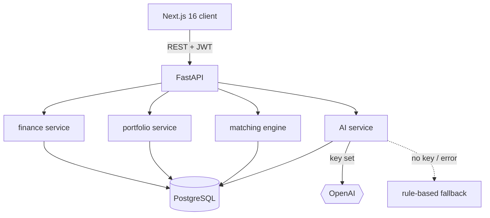
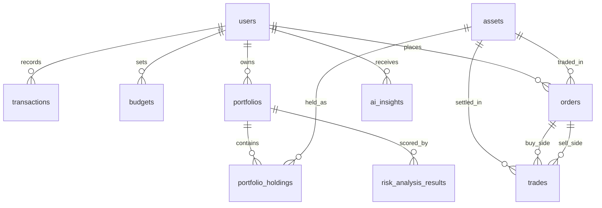

# Exchange: Financial Analytics Dashboard

Part of the [trading platform](../README.md). Run everything from the repository root with `docker compose up --build`.

A full-stack personal-finance and portfolio app: transaction tracking with a financial health score, a portfolio risk analyzer, a simulated exchange (limit-order book, settlement and a market maker) that the [trading engine](../engine) trades on, and an AI assistant that falls back to rule-based answers when no OpenAI key is configured. FastAPI and PostgreSQL on the backend, Next.js 16 on the frontend.

> Educational project. Nothing here is financial advice.

---

## Quick Start

```bash
# from the repository root: the whole platform
docker compose up --build
# UI: http://localhost:3001   API docs: http://localhost:8001/docs
docker compose exec exchange-api python app/db/seed.py   # demo data; sign in as test0@example.com / password123

# or only this app, locally
cd backend && pip install -r requirements.txt && DATABASE_URL=sqlite:///./exchange.db uvicorn app.main:app --port 8001
cd frontend && npm ci && NEXT_PUBLIC_API_URL=http://localhost:8001 npm run dev
```

The API image is published to GHCR on every release tag (`ghcr.io/yigitsarpavci/trading-platform-exchange-api`).

---

## Screenshots

Captured with the seeded demo data (50 users, 2,500+ transactions).


| | |
|---|---|
|  |  |
| *Overview* | *Personal finance: cash flow, expense breakdown, health score* |
|  |  |
| *Portfolio risk analyzer: allocation, diversification, risk score* | *Trading simulator with limit-order matching* |

---

## What It Does

- **Personal finance.** Income/expense tracking, category breakdowns, monthly cash flow, and a 0–100 health score: 50 base points, up to +30 for the savings rate (full marks at 20%), −20 when expenses exceed income.
- **Portfolio risk.** Allocation by holding and asset class, a weighted risk score (Crypto 90, Stocks 60, ETFs 50, Bonds 30, Cash 10 …) mapped to Conservative / Balanced / Aggressive, and a diversification score (10 points per holding, −10 or −20 when the largest position exceeds 30% or 50%).
- **Simulated exchange.**
  - Orders match on **price-time priority**: a buy takes the cheapest resting sell at or below its limit, oldest first, and vice versa. Fills execute at the resting (maker) price and can be partial across several counter-orders; a user's own resting orders are skipped.
  - **Pre-trade checks:** a buy needs free cash and a sell needs free holdings; open orders reserve both. A failed check returns 400 and stores nothing.
  - **Settlement:** every fill moves cash between the two accounts and updates both trading portfolios (quantity, average price, allocation), so the risk analyzer sees exchange positions.
  - **Time in force:** GTC orders rest on the book, IOC orders cancel whatever does not fill at once. Open orders can be canceled.
  - **Market data and liquidity:** accounts listed in `MARKET_OPERATOR_EMAILS` publish reference prices (`PUT /market/prices`); a built-in market maker then re-quotes a bid and an ask around each price (10 bps spread, 50,000 per side by default).
- **AI assistant.** Builds a prompt from the user's cash flow and portfolio and asks `gpt-3.5-turbo`. With no key, or on any API error, it returns a deterministic rule-based answer instead. Every answer, including fallbacks, is stored in `ai_insights` as history.
- **Auth.** Registration and login with bcrypt-hashed passwords and HS256 JWTs; every data endpoint is scoped to the signed-in user.

## Architecture



Ten tables, created by the Alembic migration `ff5987b73cdb_initial_schema`; `3c1e5a9b7d20` adds cash balances, reference prices and time in force (startup adds the same columns to older databases):



---

## Design Decisions & Trade-offs

- **Matching runs synchronously inside the request, one asset at a time.** Placing an order locks the asset row (`SELECT … FOR UPDATE` on PostgreSQL), checks funds, matches and settles in one transaction, so a client gets its fills in the response and two orders on the same asset cannot both take the same resting order. The cost is that matching throughput is bound to the web worker.
- **A market maker instead of a bot-only book.** Without liquidity an IOC order from the trading engine would never fill. Quoting around operator-published prices gives a real spread to pay and real partial fills. The maker has an unlimited balance sheet (it is topped up), so its cash and inventory are not a P&L.
- **Maker-price execution.** Filling at the resting order's price rewards liquidity providers and is how most limit-order books behave; the incoming order can only get the same or a better price than its limit.
- **Deterministic AI fallback.** The assistant must work without a key (CI, demos, outages), and the fallback keeps responses testable. Storing every answer gives a history view without a second call.
- **Scores are transparent heuristics.** The health, risk and diversification scores are simple, documented formulas rather than a model, so a user can see why a number moved.
- **Service layer separate from routes.** Routes stay thin; the scoring and matching logic lives in `app/services` and is what the tests and the coverage gate target.

## Known Limitations

- **Limit orders only** (GTC and IOC); no market or stop orders, and no fees.
- **Exchange prices come from an operator**, not from trades on the book; with no operator running, the market maker does not quote.
- **Risk uses cost basis.** Allocation is computed from average buy prices, not live market prices.
- **The JWT lives in `localStorage`,** which is readable by any script on the page; an `HttpOnly` cookie would be safer.
- **The AI model is fixed** to `gpt-3.5-turbo` in code.

---

## API

Interactive docs at `/docs`. All routes are under `/api/v1`.

| Area | Endpoints |
| :--- | :--- |
| Auth | `POST /auth/register`, `POST /auth/login`, `GET /auth/me` |
| Finance | `GET /finance/monthly-summary`, `/category-breakdown`, `/cash-flow`, `/financial-health-score` |
| Transactions | `GET`, `POST /transactions/` |
| Portfolio | `GET /portfolio/`, `POST /portfolio/assets`, `GET /portfolio/allocation`, `GET /portfolio/risk-analysis` |
| Trading | `POST /trading/orders` (GTC / IOC), `DELETE /trading/orders/{id}`, `GET /trading/orders`, `GET /trading/account`, `GET /trading/order-book`, `GET /trading/trades` |
| Market data | `GET /market/prices`, `PUT /market/prices` (market operators only) |
| AI | `POST /ai/financial-summary`, `/portfolio-risk-summary`, `/monthly-report`, `GET /ai/insights` |

## Configuration

For local runs, copy `.env.example` to `.env`; the root `docker-compose.yml` sets everything for the platform stack.

| Variable | Required | Description |
| :--- | :---: | :--- |
| `DATABASE_URL` | yes | PostgreSQL connection string |
| `SECRET_KEY` | yes | JWT signing key (`openssl rand -hex 32`) |
| `ALGORITHM`, `ACCESS_TOKEN_EXPIRE_MINUTES` | no | JWT algorithm (HS256) and lifetime |
| `FRONTEND_CORS_ORIGINS` | no | Comma-separated browser origins allowed by the API |
| `OPENAI_API_KEY` | no | Enables LLM answers; without it the rule-based fallback is used |
| `MARKET_OPERATOR_EMAILS` | no | Accounts allowed to publish reference prices, e.g. `trading-engine@example.com` |
| `MARKET_MAKER_SPREAD_BPS`, `MARKET_MAKER_QUOTE_NOTIONAL` | no | Market maker spread (default 10 bps) and size per side (default 50,000) |

## Testing

```bash
cd backend && PYTHONPATH=. pytest app/tests/   # or: docker compose exec exchange-api pytest app/tests/
```

36 pytest tests cover bcrypt hashing (salting, hashes created elsewhere, long and malformed inputs), JWT creation and validation, the monthly summary, category breakdown and health score, portfolio risk analysis, order matching (no match, full, partial, price-time priority), the exchange against a real SQLite database (cash and holding checks with reservations, settlement at the maker price, IOC remainders, self-trade prevention, cancellation, market-maker quotes and re-quotes, a round trip paying the spread, the operator-only price endpoint, the order endpoint's 400 on a failed check), the AI fallback paths, and startup creation of the ten tables plus the schema upgrade of older databases. Service-layer coverage is 85% and CI fails below 70%.

GitHub Actions runs the tests against a PostgreSQL service, ESLint plus a production Next.js build, and a Docker build with an import smoke test. CodeQL and Dependabot run on the repository.

## License

[MIT](../LICENSE) · Yiğit Sarp Avcı · [GitHub](https://github.com/yigitsarpavci) · [LinkedIn](https://www.linkedin.com/in/yigitsarpavci)
